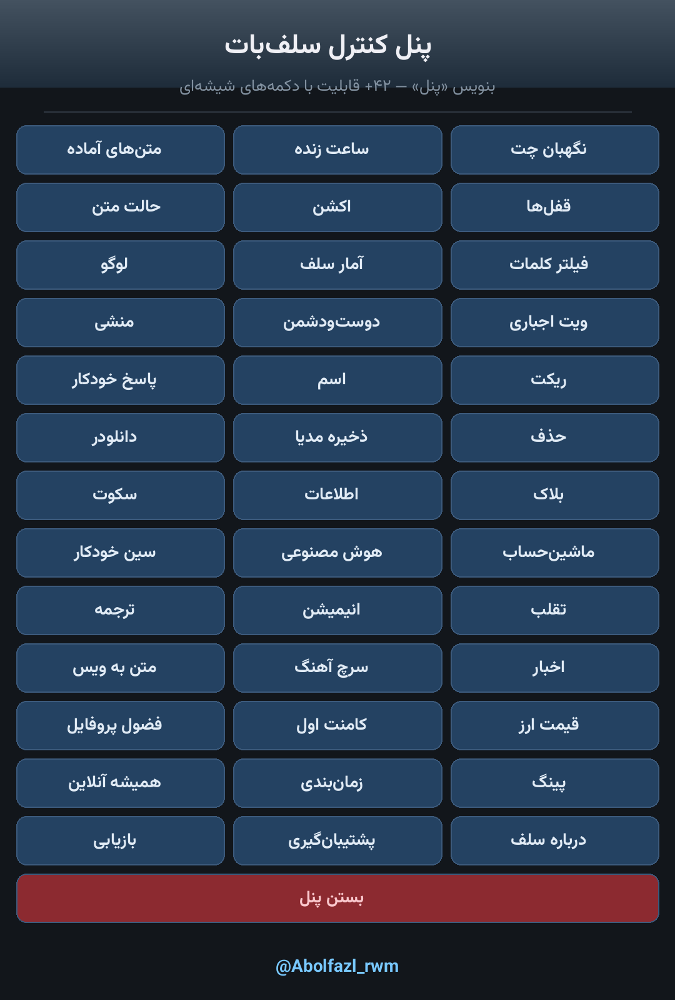
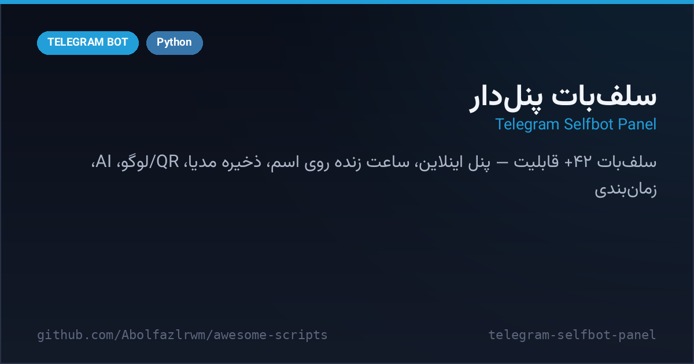

# 🎛 Telegram Selfbot Panel

A **42+ feature Telegram self-bot** built on **Telethon** (user session) + **python-telegram-bot** (inline control panel). Everything is driven from a glass-style inline panel or short Persian text commands — live name clock, auto-reactions, media saver, QR & logo generators, AI chat, music search, scheduled messages, virtual Saved-Messages folders and much more.



<p align="center"><i>Main inline panel — write «پنل» anywhere to open it</i></p>



## ✨ Highlights

- 🎛 **Inline control panel** — 40+ buttons across 3 pages, fully Persian UI
- 🕐 **Live name clock** — updates your first name with a real-time clock (6 font styles)
- 📸 **Chat guard** — saves every photo/video you send to Saved Messages
- 🅰️ **Text modes** — auto bold/italic/underline/strike/code for outgoing messages
- ❤️ **Auto reactions**, 🎬 **typing/photo/voice actions**, 🎭 **silent mode**
- ⏱️ **Scheduled messages** — `14:30 سلام` sends later, on any chat
- 📂 **Virtual Saved folders** — videos / photos / music / voices / gifs / files / texts / links, auto-categorized
- 🧰 **Toolkit** — QR generator, logo maker (5 styles), text animations, fancy Unicode fonts, calculator, translator
- 🎨 **AI chat** via OpenRouter (optional key) with a free fallback
- 🎵 **Music search & download** (yt-dlp), 🎙 text-to-speech (gTTS)
- 📰 **News feeds** & 💰 **USD/gold price** lookup
- 🏆 **Secretary**, 💬 **auto reply**, 🚫 **word filters**, ⚔️ friends/enemies lists
- 🕵️ **Profile spy**, 🥇 **first-comment**, 📥 **save-channel**, 🔮 **Hafez fortune**
- 📊 **Self stats**, ping, backup/restore of settings as a JSON file
- 🧹 **PV cleaner** — delete both-side messages of a chat (up to a limit)

## 🚀 Quick start

```bash
cd telegram-selfbot-panel
python3 -m venv .venv && . .venv/bin/activate
pip install -r requirements.txt
cp .env.example .env      # fill API_ID / API_HASH / BOT_TOKEN / ADMIN_ID
python main.py
```

1. Get `API_ID` & `API_HASH` from [my.telegram.org](https://my.telegram.org) → *API development tools*.
2. Get a panel bot token from [@BotFather](https://t.me/BotFather) and put its username in `BOT_USERNAME`.
3. Get your numeric ID from [@userinfobot](https://t.me/userinfobot) → `ADMIN_ID`.
4. Log in once with your **own phone number** (a `user_session` file is created — never share it).
5. In any chat type `پنل` to open the panel, or `هلپ` for the command guide.

<details>
<summary><b>🇮🇷 نسخه فارسی</b></summary>

# 🎛 سلف‌بات پنل‌دار تلگرام

سلف‌باتی با **بیش از ۴۲ قابلیت** که روی **Telethon** (سشن شخصی) + **python-telegram-bot** (پنل اینلاین) ساخته شده. همه‌چیز از پنل دکمه‌ای یا دستورهای متنی کوتاه فارسی کنترل می‌شه — ساعت زنده روی اسم، ریکت خودکار، ذخیره مدیا، سازنده QR و لوگو، چت هوش مصنوعی، سرچ آهنگ، پیام زمان‌بندی‌شده، پوشه‌های مجازی سیو و خیلی بیشتر.


## ✨ قابلیت‌های مهم

- 🎛 **پنل اینلاین کامل** — بیش از ۴۰ دکمه در ۳ صفحه، رابط فارسی
- 🕐 **ساعت زنده روی اسم** — اسم اکانت هر لحظه با ساعت جاری آپدیت می‌شه (۶ فونت)
- 📸 **نگهبان چت** — هر عکس/ویدیویی که می‌فرستی خودکار در سیو ذخیره می‌شه
- 🅰️ **حالت متن** — بولد/کج/زیرخط/خط‌خورده/کد خودکار برای پیام‌های بعدی
- ❤️ **ریکت خودکار**، 🎬 **اکشن تایپینگ/عکس/ویس**، 🎭 **حالت سکوت**
- ⏱️ **زمان‌بندی پیام** — مثلاً `14:30 سلام` در هر چتی
- 📂 **پوشه‌های مجازی سیو** — فیلم/عکس/موزیک/ویس/گیف/فایل/متن/لینک، دسته‌بندی خودکار
- 🧰 **جعبه‌ابزار** — ساخت QR، لوگو (۵ استایل)، انیمیشن متنی، فونت‌های فانتزی، ماشین‌حساب، ترجمه
- 🎨 **چت هوش مصنوعی** با OpenRouter (کلید اختیاری) + فال‌بک رایگان
- 🎵 **سرچ و دانلود آهنگ**، 🎙 تبدیل متن به ویس
- 📰 **اخبار** و 💰 **قیمت دلار و طلا**
- 🏆 **منشی**، 💬 **پاسخ خودکار**، 🚫 **فیلتر کلمات**، ⚔️ لیست دوستان و دشمنان
- 🕵️ **فضول پروفایل**، 🥇 **کامنت اول**، 📥 **سیو کانال**، 🔮 **فال حافظ**
- 📊 **آمار سلف**، پینگ، پشتیبان‌گیری و بازیابی تنظیمات با فایل JSON
- 🧹 **پاک‌ساز پیوی** — حذف دوطرفه پیام‌های یک چت تا سقف مشخص

## 🚀 راه‌اندازی سریع

```bash
cd telegram-selfbot-panel
python3 -m venv .venv && . .venv/bin/activate
pip install -r requirements.txt
cp .env.example .env      # مقادیر API_ID / API_HASH / BOT_TOKEN / ADMIN_ID را پر کن
python main.py
```

1. `API_ID` و `API_HASH` را از [my.telegram.org](https://my.telegram.org) بگیر.
2. یک ربات پنل از [@BotFather](https://t.me/BotFather) بساز؛ توکن و یوزرنیمش را در `.env` بگذار.
3. آیدی عددی خودت را از [@userinfobot](https://t.me/userinfobot) بگیر و در `ADMIN_ID` بگذار.
4. اولین اجرا با **شماره خودت** لاگین می‌شود (فایل `user_session` ساخته می‌شود — هرگز کسی نده).
5. در هر چت بنویس `پنل` تا منو باز شود، یا `هلپ` برای راهنمای دستورها.

</details>

## ⚙️ Configuration (`.env`)

| Variable | Description |
| --- | --- |
| `API_ID` / `API_HASH` | Telegram API credentials from my.telegram.org |
| `BOT_TOKEN` | Token of the panel bot (@BotFather) |
| `BOT_USERNAME` | That bot's username (used for inline panel) |
| `ADMIN_ID` | Your numeric ID — the only user allowed to use everything |
| `STATE_FILE` | Optional state path (default `state.json`) |

## ⚠️ Warning / Disclaimer

- This is a **self-bot**: it runs on **your personal account** through the Telegram API. Automating user accounts **violates the Telegram ToS** and can lead to a temporary or permanent **account ban** — use at your own risk, ideally on a secondary account.
- The admin/executive features (mass mentions, spam/kill/burn workers, ban-all, PV cleaner…) are included **as-is** for transparency because they exist in the source. **Abusing them against groups or people is harassment** and will get your account restricted fast. Be responsible — use them only on your own test groups.
- Only `ADMIN_ID` can operate the bot; never publish your `.env`, `user_session*` or `state.json`.

<div align="center">

**Maintained by [@Abolfazl_rwm](https://t.me/Abolfazl_rwm)** · MIT License

</div>
