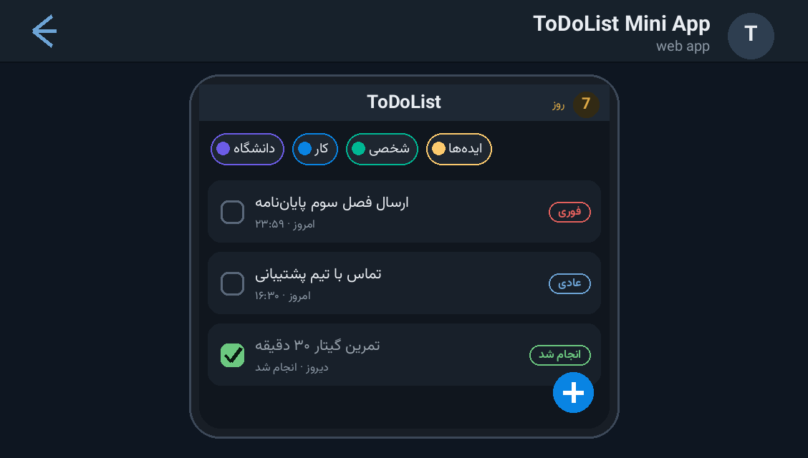

# ✅ ToDoList Mini App — تودولیست مینی‌اپ (Cloudflare Worker)

A **complete Telegram Mini App productivity suite** shipped as **one Cloudflare
Worker file**: the REST API, the bot webhook, a cron reminder dispatcher and the
whole Mini App frontend (HTML/CSS/JS embedded) live in `worker.js`. Data is stored
in **Cloudflare D1** (SQLite at the edge). No other service, no external storage.

مجموعه‌ی کامل بهره‌وری به‌شکل مینی‌اپ تلگرام در **یک فایل Worker کلادفلر**: API رست،
وب‌هوک ربات، کرون یادآور و کل فرانت‌اند مینی‌اپ داخل `worker.js`. دیتا در **D1** ذخیره می‌شود.



---

## ✨ Features — امکانات

| | |
| --- | --- |
| 📝 **Tasks** | categories, priorities, colors/icons, due date+time, soft delete, search |
| 🔁 **Recurring tasks** | weekly recurrence by weekday — instances are auto-generated from a template |
| ⏰ **Reminders** | per-task reminder offsets, dispatched by a **cron trigger every minute** |
| 🌍 **Per-user timezone** | reminders are computed with the user's own IANA timezone (DST-safe), not a fixed offset |
| 🗓 **Jalali calendar** | server-side Persian calendar math (month lengths, weekday alignment) |
| 🔥 **Habits & streaks** | daily goals, streak counters, milestone badges (3/7/30/100), best-streak & success rate |
| 🗒 **Notes** | colored notes with **file attachments sent through Telegram** (stored as `telegram_file_id`) |
| 🔒 **PIN lock** | optional app PIN with salted hash + brute-force lockout |
| 🤖 **AI chat history** | per-user AI message log (role/content) with reset |
| 🛡 **Security** | Telegram `initData` validated with **HMAC-SHA256** (`WebAppData` secret) + 24h auth-date window |
| 💬 **Smart bot messages** | auto-splits long texts at 4096 chars — never breaks sentences or open HTML tags |
| 📣 **Support banner** | embedded JPEG banner sent on demand — no external storage needed |

## 🚀 Deploy — راه‌اندازی

```bash
cd src/todo-miniapp-worker
npm install -g wrangler
wrangler login

# 1) create the D1 database and put its id in wrangler.toml
wrangler d1 create todolist

# 2) apply the schema
wrangler d1 execute todolist --remote --file schema.sql

# 3) secrets
wrangler secret put BOT_TOKEN        # from @BotFather
wrangler secret put MINI_APP_URL     # https://<your-worker>.workers.dev  (the Mini App URL)
wrangler secret put WEBHOOK_SECRET   # optional — random string

# 4) ship it
wrangler deploy
```

Then open **`https://<your-worker>.workers.dev/setup`** once — it registers the
Telegram webhook (`/webhook/bot`) automatically. Open the bot, press
**🚀 باز کردن ToDoList** and start using the app.

سپس یک بار آدرس `/setup` را باز کنید تا وب‌هوک تلگرام ثبت شود، بعد در ربات دکمه‌ی
«🚀 باز کردن ToDoList» را بزنید.

## 🗺 Endpoints — مسیرها

| Route | Purpose |
| --- | --- |
| `POST /webhook/bot` | Telegram updates (messages, joins) |
| `GET /` · `GET /app` | the Mini App frontend |
| `GET /setup` | one-shot webhook registration helper |
| `POST /api/v1/*` | the Mini App REST API (auth via Telegram `initData` header) |
| `scheduled` (cron `* * * * *`) | reminder dispatcher + recurring-task generator |

## 📁 Files — فایل‌ها

```
todo-miniapp-worker/
├── worker.js          # the entire backend + frontend (one file)
├── wrangler.toml      # D1 binding, cron trigger, secrets doc
├── schema.sql         # D1 tables (users, tasks, reminders, habits, notes, …)
└── docs/preview.png   # demo screenshot
```

## 🧠 How it works — معماری

- **One worker, four jobs**: the same file serves the API router, the bot webhook,
  the cron dispatcher and the embedded SPA frontend — deploy is a single `wrangler deploy`.
- **Auth**: every API call carries Telegram `initData`; it is re-signed locally with
  `HMAC_SHA256("WebAppData", bot_token)` and compared to the Telegram hash, so no
  password or session store is needed.
- **Time correctness**: `zonedTimeToUtcTimestamp()` iterates the real IANA offset
  (with a DST convergence loop) — reminders fire at the user's local time even across
  DST changes; the calendar view aligns with the server-side Jalali month math.
- **D1 tables**: `users, categories, tasks, reminders, habits, habit_logs, badges,
  notes, note_attachments, ai_messages` — see `schema.sql`.

## 📄 License — لایسنس

MIT — see the repository root.
