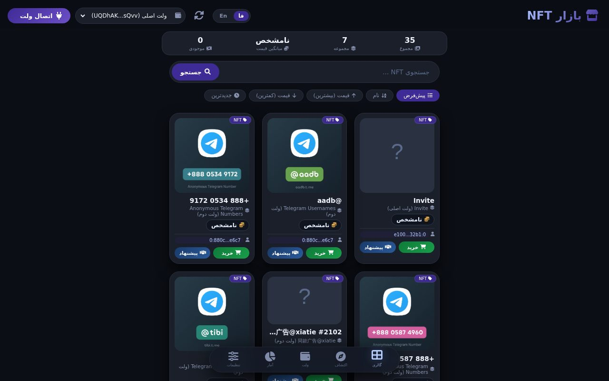

# 💎 TON NFT Marketplace — مارکت‌پلیس NFT روی تون

> 📬 **Telegram:** [@Abolfazl_rwm](https://t.me/Abolfazl_rwm)

A **TON-connect NFT marketplace UI** in one HTML file — connect a TON wallet (tonconnect-ui), browse the NFT gallery, inspect card details, list/buy with TON pricing, and switch between Persian/English. Perfect starter dApp for TON collections.

رابط مارکت‌پلیس NFT با اتصال TON در یک فایل HTML — اتصال والت با tonconnect-ui، گالری NFT، جزئیات کارت، خرید و لیست‌کردن با قیمت TON و سوییچ فارسی/انگلیسی. نقطه‌ی شروع عالی برای dApp کالکشن‌های تون.

  
[**Live demo**](https://abolfazlrwm.github.io/awesome-scripts/src/ton-nft-marketplace/)

---

## ✨ Features — امکانات

| | |
| --- | --- |
| 👛 **TON Connect UI** | official `@tonconnect/ui@2` widget for wallet connect/disconnect |
| 🖼 **NFT gallery** | card grid with badges, filtering controls and detail modal |
| 🛒 **Buy flow** | purchase modal with price, confirm/cancel actions |
| 🌐 **Bilingual toggle** | fa/en switch (RTL aware) in the header |
| 📱 **App-style chrome** | bottom menu + header actions — feels like a native mini app |

## 🚀 Setup — نصب و اجرا

```bash
cd src/ton-nft-marketplace
python3 -m http.server 8080
# باز کنید: http://localhost:8080
```

برای اتصال واقعی والت، `tonconnect-manifest.json` مخصوص دامنه‌ی خودتان را جای دموی فعلی ست کنید.

## 📁 Files — فایل‌ها

```
ton-nft-marketplace/
├── index.html           # کل dApp (UI + منطق گالری/خرید)
└── docs/preview.png
```

## 🧠 How it works — معماری

- **Demo manifest**: currently points at ton-connect's public demo dapp — replace with your own manifest for production wallets.
- **Marketplace-ready layout**: gallery, badges and modal flows map 1:1 to a real NFT contract integration.
- **Static dApp**: everything client-side; add a TonApi/TON Center backend when you go live.

## 📄 License — لایسنس

MIT — see the repository root.
