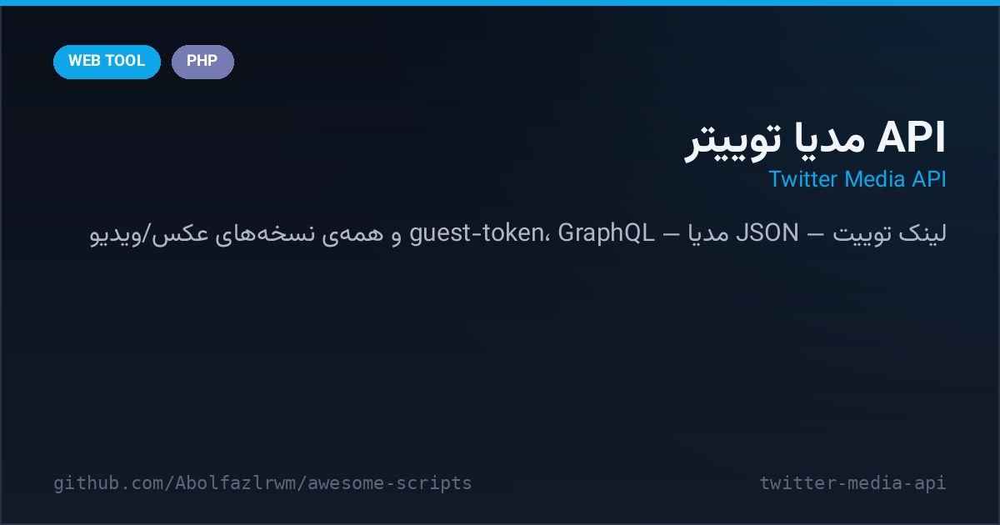

# 🐦 Twitter Media API — API دانلود مدیا از X (توییتر)

> 📬 **Telegram:** [@Abolfazl_rwm](https://t.me/Abolfazl_rwm)

A tiny PHP endpoint that resolves any tweet URL into its **media files** — performs the guest-token handshake against api.x.com, calls the TweetDetail GraphQL operation, and returns JSON with all photo/video variants. Perfect as a downloader backend.

یک اندپوینت کوچک PHP که هر لینک توییت را به فایل‌های مدیایش تبدیل می‌کند — احراز guest-token با api.x.com، فراخوانی GraphQL تعریف TweetDetail و خروجی JSON شامل همه‌ی نسخه‌های عکس/ویدیو. مناسب به‌عنوان بک‌اند دانلودر.



---

## ✨ Features — امکانات

| | |
| --- | --- |
| 🎟 **Guest-token flow** | auto-activates and caches `guest_token.txt`, refreshes on expiry |
| 🔎 **GraphQL TweetDetail** | modern query variables + features payload for api.x.com |
| 🧾 **Clean JSON out** | GET `?url=<tweet>` → media list, tweet text, author info |
| 🍪 **Cookie jar** | Guzzle FileCookieJar keeps session cookies across calls |
| 🛡 **Input validation** | URL parser rejects non-tweet links before any request |

## 🚀 Setup — نصب و اجرا

```bash
cd src/twitter-media-api
composer install          # guzzlehttp/guzzle
export X_BEARER_TOKEN="AAAA..."   # توکن عمومی وب یا توکن خودت
php -S localhost:8080 index.php
# تست:
curl "http://localhost:8080/?url=https://x.com/user/status/123456789"
```

## 📁 Files — فایل‌ها

```
twitter-media-api/
├── index.php            # اندپوینت + منطق GraphQL
├── config.php           # توکن‌ها، UA، مسیر کش
├── composer.json
└── docs/preview.png
```

## 🧠 How it works — معماری

- **Guest auth**: `POST /1.1/guest/activate.json` with the public web bearer issues a guest token cached to disk until it stops working.
- **Resilient parsing**: media extraction walks `extended_entities` then falls back to `entities` — photos, GIFs and all video bitrates are covered.
- **Self-host only**: X rate-limits guest traffic; put your own cache/keys in front for production.

## 📄 License — لایسنس

MIT — see the repository root.
