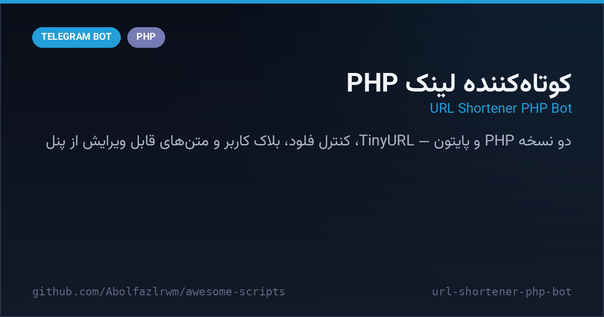

# 🔗 URL Shortener PHP Bot — کوتاه‌کننده لینک (نسخه PHP و پایتون)

A dual-implementation **URL shortener bot** — the same product in PHP and Python. Send a link, get a TinyURL short back; settings (start/help text, force join) live in SQLite and are editable from the admin panel; flood control and user blocking included.

ربات کوتاه‌کننده لینک با دو پیاده‌سازی هم‌ارز (PHP و پایتون) — لینک بفرست، نسخه کوتاه TinyURL بگیر؛ تنظیمات متن استارت/راهنما و جوین اجباری در SQLite است و از پنل ادمین قابل ویرایش است؛ کنترل فلود و بلاک کاربر هم دارد.



---

## ✨ Features — امکانات

| | |
| --- | --- |
| 🔗 **TinyURL API** | instant short links for any URL you send |
| 🛡 **Flood control** | per-user message counting with timed mutes |
| ⛔ **User blocking** | admin can block/unblock users; blocked users get no service |
| 📢 **Force join** | channel gate stored in settings, toggleable from the panel |
| 📝 **Editable texts** | start/help messages stored in DB — edit without touching code |
| 🧰 **Two stacks, one product** | `bot.php` (PHP + SQLite3) and `bot.py` (Python + sqlite3) |

## 🚀 Setup — نصب و اجرا

**PHP:**
```bash
cd src/url-shortener-php-bot
export BOT_TOKEN="123:ABC..."
curl "https://api.telegram.org/bot<TOKEN>/setWebhook?url=https://<host>/bot.php"
```

**Python:**
```bash
python3 -m venv venv && source venv/bin/activate
pip install -r requirements.txt
export BOT_TOKEN="123:ABC..."
python bot.py
```

## 📁 Files — فایل‌ها

```
url-shortener-php-bot/
├── bot.php              # پیاده‌سازی PHP (webhook + SQLite3)
├── bot.py               # پیاده‌سازی پایتون (long polling + sqlite3)
├── requirements.txt
└── docs/preview.png
```

## 🧠 How it works — معماری

- **Settings table**: `force_join`, `channel_id`, `start_message`, `help_message` are rows — the admin panel edits them live.
- **Rate limiting**: `last_message_time` + `message_count` per user implement a soft cooldown with auto-mute.
- **Identical behavior**: both implementations share the same schema so you can switch runtimes without losing data.

## 📄 License — لایسنس

MIT — see the repository root.
