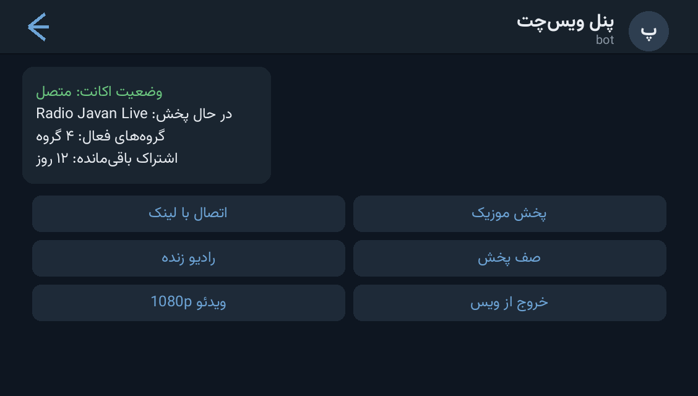

# 🎙 VoiceChat Userbot Panel — پنل یوزربات ویس‌چت تلگرام

> 📬 **Telegram:** [@Abolfazl_rwm](https://t.me/Abolfazl_rwm)

A Telethon **userbot + bot panel** that joins Telegram Voice Chats and streams media
into them: connect by public/private invite links (up to 20 per batch), auto-enter
any **already-active** Voice Chat, play local audio files, search & play YouTube via
`yt-dlp`, stream video up to 1080p, per-group persistent playlists, live radio/TV
links, group subscription management, and a button-based admin panel with banner
photos and QR login.

یوزربات + پنل رباتی مبتنی بر Telethon برای ورود به ویس‌چت و پخش صدا/ویدئو — اتصال با
لینک عمومی/خصوصی (تا ۲۰ لینک در هر نوبت)، ورود خودکار به ویس فعال، پخش فایل/یوتیوب/رادیو،
پلی‌لیست دائمی هر گروه، مدیریت اشتراک و پنل دکمه‌ای با بنر و ورود QR.



---

این پروژه شامل دو بخش است:

1. یک اکانت واقعی تلگرام که عضو گروه می‌شود و وارد Voice Chat می‌شود.
2. یک ربات BotFather که پنل دکمه‌ای مدیریت را نمایش می‌دهد.

## قانون قطعی تماس

در تمام مسیرهای اتصال، `GroupCallConfig(auto_start=False)` تنظیم شده است. بنابراین برنامه فقط وارد Voice Chat از قبل فعال می‌شود و اگر تماس فعالی وجود نداشته باشد، هرگز تماس جدید ایجاد نمی‌کند.

## امکانات پنل

- دریافت لینک عمومی گروه یا کانال و عضوکردن اکانت
- دریافت لینک دعوت خصوصی و عضوکردن اکانت
- دریافت هم‌زمان حداکثر ۲۰ لینک عمومی/خصوصی (هر خط یک لینک)
- ورود خودکار به Voice Chat فعال بعد از عضویت
- ثبت خودکار گروه‌های ارسال‌شده در پنل و پایش دوره‌ای آن‌ها برای Auto Join
- افزودن، تعویض یا حذف عکس بنر منوی اصلی از داخل پنل
- نمایش و بررسی سلامت اکانت متصل
- پخش فایل صوتی ارسالی یا لینک مستقیم صدا
- جست‌وجو و پخش از یوتیوب با `yt-dlp`
- پخش ویدئو با کیفیت انتخابی 360p تا 1080p
- صف پخش خودکار و رفتن به آهنگ بعدی پس از پایان
- پلی‌لیست دائمی جداگانه برای هر گروه
- تعریف و پخش لینک‌های زنده رادیو و تلویزیون
- مدیران پخش مستقل برای هر گروه
- ثبت، تمدید، لغو و الزام اختیاری اشتراک گروه‌ها
- توقف موقت، ادامه، قطع صدا و خروج از تماس
- نمایش وضعیت اتصال
- مدیریت ادمین‌های پنل توسط مالک
- نمایش اعتبار اشتراک
- دکمه‌های کانال و پشتیبانی
- پایش اختیاری گروه‌های مشخص‌شده در `.env`

نسخه حاضر عمداً یک اکانت واقعی را مدیریت می‌کند. برای امنیت، کد ورود و رمز دومرحله‌ای داخل چت ربات دریافت نمی‌شود.

## پیش‌نیازها

- Python 3.10 یا بالاتر
- `ffmpeg` برای پخش فایل صوتی
- `API_ID` و `API_HASH` از `my.telegram.org`
- یک ربات ساخته‌شده در BotFather و توکن آن

## راه‌اندازی

### نصب آسان روی Linux یا cPanel

بعد از Extract کردن فایل ZIP، در Terminal وارد پوشه پروژه شوید و فقط این دستور را اجرا کنید:

```bash
bash install.sh
```

نصب‌کننده نسخه مناسب Python و FFmpeg را بررسی می‌کند، محیط مجازی و وابستگی‌ها را می‌سازد و اطلاعات اولیه را می‌پرسد. سپس ربات را اجرا کنید، در تلگرام `/start` بفرستید و با دکمه ورود QR اکانت را متصل کنید. کد ورود و رمز دومرحله‌ای داخل چت دریافت نمی‌شود.

مدیریت بعد از نصب:

```bash
./botctl start
./botctl stop
./botctl restart
./botctl status
./botctl logs
```

در بعضی هاست‌های اشتراکی cPanel پردازش پس‌زمینه پس از مدتی بسته می‌شود. در آن حالت باید از VPS یا قابلیت اجرای دائمی برنامه در هاست استفاده کنید.

### نصب دستی

فایل `.env.example` را با نام `.env` کپی کنید و این مقدارها را پر کنید:

```env
API_ID=12345678
API_HASH=your_api_hash
SESSION_STRING=your_telethon_string_session
BOT_TOKEN=123456789:your_bot_token
OWNER_ID=your_numeric_telegram_id
```

وابستگی‌ها را نصب کنید:

```bash
python -m venv .venv
source .venv/bin/activate
pip install -r requirements.txt
```

در ویندوز به‌جای `source`:

```powershell
.venv\Scripts\activate
```

## ساخت SESSION_STRING

ابتدا فقط `API_ID` و `API_HASH` را در `.env` قرار دهید، سپس روی سیستم یا سرور خودتان اجرا کنید:

```bash
python generate_session.py
```

شماره، کد ورود و در صورت فعال‌بودن رمز دومرحله‌ای پرسیده می‌شود. خروجی را در `SESSION_STRING` بگذارید. این رشته دسترسی کامل اکانت است و نباید برای کسی ارسال شود.

## اجرای برنامه

```bash
python main.py
```

سپس در ربات پنل دستور `/start` را بزنید. فقط `OWNER_ID` و آیدی‌های موجود در `ADMIN_IDS` اجازه استفاده دارند.

## اتصال با لینک

در پنل یکی از این دو دکمه را بزنید:

- `اتصال به لینک عمومی`: مانند `https://t.me/group_username`
- `اتصال به لینک خصوصی`: مانند `https://t.me/+AbCdEf...`
- `اتصال چند لینک`: لینک‌های عمومی و خصوصی را هرکدام در یک خط بفرستید (حداکثر ۲۰ لینک در هر نوبت)

اکانت ابتدا عضو مقصد می‌شود. سپس برنامه وجود تماس فعال را بررسی می‌کند:

- اگر تماس فعال باشد، اکانت وارد آن می‌شود.
- اگر تماس فعال نباشد، فقط عضویت انجام می‌شود و پیام «هیچ تماس جدیدی ایجاد نشد» نمایش داده می‌شود.

هر گروهی که لینکش از پنل ارسال شود به فهرست Auto Join اضافه می‌شود. وقتی دکمه `Auto Join` روشن باشد، برنامه گروه‌های ثبت‌شده را دوره‌ای بررسی می‌کند و فقط در صورت وجود Voice Chat فعال وارد می‌شود. از همان بخش می‌توان فهرست گروه‌های ثبت‌شده را پاک کرد.

برای گذاشتن تصویر بالای منوی اصلی، از دکمه `مدیریت عکس پنل` استفاده کنید. فقط مالک اصلی می‌تواند این تصویر را اضافه، تعویض یا حذف کند. تصویر در مسیر پایدار `data/panel-image.jpg` نگه‌داری می‌شود.

## اجرای Docker

```bash
docker compose build
docker compose up -d
docker compose logs -f
```

پوشه `data` فهرست ادمین‌ها و آخرین مقصد هر ادمین را نگه می‌دارد. پوشه `downloads` برای فایل‌های صوتی است.

اگر FFmpeg سیستمی روی هاست موجود نباشد، وابستگی `imageio-ffmpeg` یک باینری محلی فراهم می‌کند و برنامه آن را خودکار در مسیر اجرا قرار می‌دهد.

## پایش خودکار گروه‌های ثابت

برای بررسی دوره‌ای گروه‌های مشخص، آیدی‌ها را با ویرگول در `.env` قرار دهید:

```env
ALLOWED_CHAT_IDS=-1001234567890,-1009876543210
AUTO_JOIN=true
SCAN_INTERVAL=20
```

در این حالت نیز برنامه فقط به تماس فعال می‌پیوندد و هیچ Voice Chat جدیدی ایجاد نمی‌کند.

## دستورهای مستقیم اکانت

| دستور | کاربرد |
| --- | --- |
| `.vcid` | نمایش آیدی گروه |
| `.vcjoin` | ورود به تماس فعال گروه فعلی |
| `.vcjoin -100...` | ورود به تماس فعال با آیدی گروه |
| `.vcleave` | خروج از تماس |

## فرمان‌های موزیک‌پلیر داخل گروه

این فرمان‌ها را مدیر گروه، مدیر پنل یا مدیر پخش می‌تواند ارسال کند:

| فرمان | کاربرد |
| --- | --- |
| `پخش نام آهنگ` یا `/play name` | جست‌وجوی یوتیوب و پخش صوت |
| `پخش` روی فایل ریپلای‌شده | دانلود و پخش فایل تلگرام |
| `ویدئو لینک` یا `/vplay link` | پخش ویدئو |
| `مکث`، `ادامه`، `توقف` | کنترل پخش |
| `بعدی` | ردکردن آهنگ و اجرای مورد بعد صف |
| `بیصدا`، `باصدا` | قطع و وصل صدای پخش |
| `صدا 100` | تنظیم حجم بین ۱ تا ۲۰۰ |
| `کیفیت 720` | انتخاب کیفیت ویدئو: 360، 480، 720 یا 1080 |
| `صف`، `پاکسازی صف` | نمایش یا پاک‌کردن صف انتظار |
| `افزودن لیست` | افزودن فایل/لینک/جست‌وجو به پلی‌لیست |
| `لیست پخش`، `اجرای لیست` | نمایش یا اجرای پلی‌لیست گروه |
| `حذف لیست 2` | حذف مورد شماره ۲ از پلی‌لیست |
| `شبکه‌ها`، `شبکه نام` | نمایش و پخش رادیو/تلویزیون تعریف‌شده |
| `اعتبار` | نمایش اعتبار گروه |
| `راهنما` | نمایش راهنمای کامل داخل گروه |

برای افزودن یا حذف مدیر پخش، روی پیام کاربر ریپلای کنید و `افزودن مدیر پخش` یا `حذف مدیر پخش` بفرستید. فرمان `مدیران پخش` فهرست را نمایش می‌دهد.

## مدیریت اشتراک و شبکه‌های زنده

در پنل خصوصی `/start` بزنید و وارد بخش `پخش، شبکه‌ها و اشتراک گروه` شوید. از این بخش می‌توانید:

- اشتراک گروه را با آیدی عددی و تعداد روز ثبت یا تمدید کنید.
- اشتراک گروه را لغو یا فهرست اشتراک‌ها را مشاهده کنید.
- الزام اشتراک را روشن یا خاموش کنید.
- شبکه زنده مجاز خودتان را با نام، نوع `audio` یا `video` و لینک مستقیم تعریف کنید.

برنامه هیچ فهرست تلویزیونی ناشناس یا بدون مجوزی را همراه خود ندارد؛ لینک‌های زنده را مالک پنل تعریف می‌کند.

## نکات امنیتی

- `SESSION_STRING` و `BOT_TOKEN` را برای کسی نفرستید.
- اکانت باید اجازه عضویت و ورود به Voice Chat مقصد را داشته باشد.
- فقط در گروه‌ها و کانال‌هایی استفاده کنید که اجازه فعالیت در آن‌ها را دارید.
- درخواست‌های زیاد ممکن است باعث Flood Wait یا محدودشدن اکانت شود.

مرجع PyTgCalls: <https://github.com/pytgcalls/pytgcalls>

## تست ایمنی

این تست بررسی می‌کند که هیچ مسیر کد اجازه ساخت تماس جدید نداشته باشد:

```bash
python -m unittest discover -s tests -v
```
