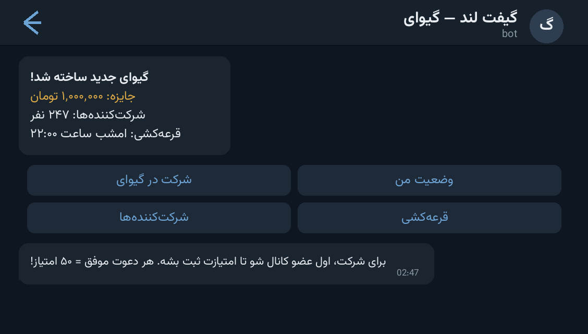

# 🎁 WinLand Giveaway Bot — ربات گیوای و قرعه‌کشی حرفه‌ای

A **WinLand-style giveaway & raffle bot** with a points economy: run multiple
giveaways at once, grow the channel with mandatory join + referrals, and draw 1–50
winners fairly. Admin panel, participant tracking and SQLite storage — one clean
`python-telegram-bot` file.

ربات گیوای/قرعه‌کشی به سبک WinLand با اقتصاد امتیازی: چند گیوای همزمان، عضویت اجباری
کانال، سیستم رفرال و امتیاز، قرعه‌کشی ۱ تا ۵۰ برنده، پنل ادمین و ذخیره‌سازی SQLite.



---

## ✨ Features — امکانات

| | |
| --- | --- |
| 🎟 **Multi-giveaway** | up to 10 active giveaways, each with its own prize text, winners and participants |
| 🏆 **1–50 winners** | fair random draw from actual participants, with per-winner announcements |
| ⭐ **Points economy** | join bonus 25, daily bonus 10, **referral bonus 50** per invited friend |
| 📢 **Mandatory channel join** | participation gated on `@YourChannel` membership (checked on demand) |
| 🧲 **Referral engine** | every user gets a `?start=<id>` deep link; rewards are credited automatically |
| 📊 **Status & participants** | live buttons for giveaway status and the participant list |
| ⏳ **Anti-abuse** | 24h participation cooldown, max-active-giveaway caps |
| 🛠 **Admin panel** | create / cancel / draw / list giveaways, view participants |
| 💾 **SQLite** | users, giveaways, entries and referral credits all persisted |

## 🚀 Setup — نصب و اجرا

```bash
cd src/winland-giveaway-bot
python3 -m venv venv && source venv/bin/activate
pip install -r requirements.txt
```

Fill the `CONFIG` dict at the top of `bot.py`:

```python
CONFIG = {
    "BOT_TOKEN": "YOUR_BOT_TOKEN_HERE",   # از @BotFather
    "ADMIN_IDS": [123456789],             # آیدی عددی ادمین‌ها
    "CHANNEL_USERNAME": "@YourChannel",   # کانال عضویت اجباری
    "CHANNEL_ID": -1001234567890,
    "BOT_USERNAME": "YourBot",            # بدون @ — برای لینک رفرال
    ...
}
```

```bash
python bot.py
```

بعد از اجرا، `/start` بزنید: امتیاز خوش‌آمد می‌گیرید، از دکمه‌ی **🎟️ Participate**
وارد گیوای‌های باز می‌شوید و با دعوت دوستان امتیاز می‌گیرید.

## 📁 Files — فایل‌ها

```
winland-giveaway-bot/
├── bot.py              # the whole bot (DB, points, giveaways, admin panel)
├── requirements.txt    # python-telegram-bot
└── docs/preview.png    # demo screenshot
```

## 🧠 How it works — معماری

- **Giveaway lifecycle**: admin creates → users join (channel check + cooldown) →
  draw (`🎲 Draw Winners`) picks N unique winners with `random.sample` → cancel is
  owner-only.
- **Points ledger**: `points`, `daily_bonus`, referrals and cooldowns live in SQLite
  tables keyed by user id — every reward is a single transaction.
- **Join gate**: channel membership is verified via `get_chat_member` before a
  participation is accepted, so the giveaway actually grows the channel.

## 📄 License — لایسنس

MIT — see the repository root.
