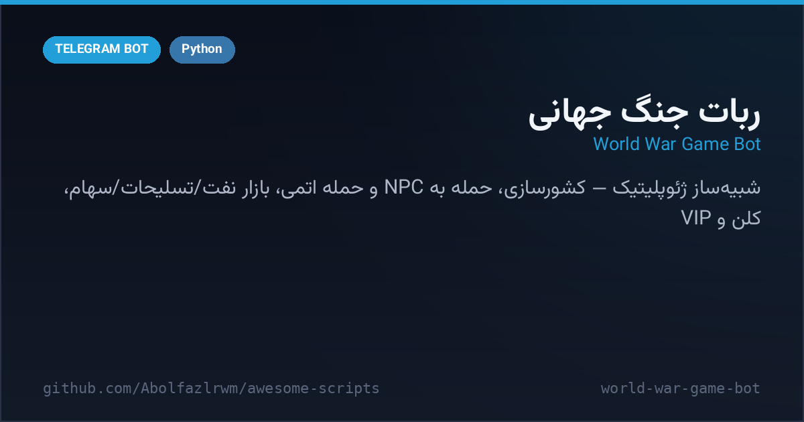

# 🌍 World War Game Bot — ربات جنگ جهانی

A full **geopolitical war simulator** for Telegram — found a country, build an army and an economy, attack NPC states or other players, trade oil, run companies, join clans, bet on wars and even launch nukes. 20+ inline menus, one SQLite database, one Python file.

شبیه‌ساز کامل جنگ و ژئوپلیتیک برای تلگرام — تاسیس کشور، ارتش و اقتصاد، حمله به کشورهای NPC و کاربران، بازار نفت و تسلیحات، کلن، شرط‌بندی و حتی حمله اتمی. یک فایل پایتون و یک دیتابیس SQLite.



---

## ✨ Features — امکانات

| | |
| --- | --- |
| 🏳️ **Country & economy** | gold, oil, army, economy & tech stats with income loops |
| ⚔️ **Attacks** | vs 10 NPC countries or real players — pick your force percentage, power formula decides |
| ☢️ **Nukes** | build a nuclear project, wipe an NPC state off the map, loot 80% of its vault |
| 🛒 **Markets** | arms shop, oil trading (buy/sell), stock market with per-country shares |
| 🏭 **Companies & VIP** | hourly company income; VIP buildings (hospital, factory, refinery…) boost everything |
| 🏰 **Clans & alliances** | clan treasury, member lists, win/loss records, group contests |
| 🎰 **Casino layer** | betting with streak tracking, daily gifts & daily missions |
| 📊 **Rankings & war map** | leaderboards, attack logs, transfer logs, channel war reports |
| 🛡 **Admin tools** | ban, add/remove points & levels — admin-only commands |

## 🚀 Setup — نصب و اجرا

```bash
cd src/world-war-game-bot
python3 -m venv venv && source venv/bin/activate
pip install -r requirements.txt
cp .env.example .env   # BOT_TOKEN (و اختیاری: ADMIN_IDS, CHANNEL_ID) را پر کن
python bot.py
```

گزارش جنگ‌ها و انتقال‌ها به `CHANNEL_ID` ارسال می‌شود اگر ست شده باشد.

## 📁 Files — فایل‌ها

```
world-war-game-bot/
├── bot.py               # کل بازی: اقتصاد، حمله، کلن، سهام، VIP
├── requirements.txt
├── .env.example
└── docs/preview.png
```

## 🧠 How it works — معماری

- **Power formula**: `calculate_attack_power` sums weighted equipment + tech + VIP buildings; win chance is `power / (power + defense)` — transparent and tunable.
- **NPC states**: seeded on first run with gold/oil/equipment; they lose resources when raided and can be annihilated by nukes.
- **Audit trail**: every attack and transfer is written to `attack_logs` / `transfers` and mirrored to the report channel.

## 📄 License — لایسنس

MIT — see the repository root.
