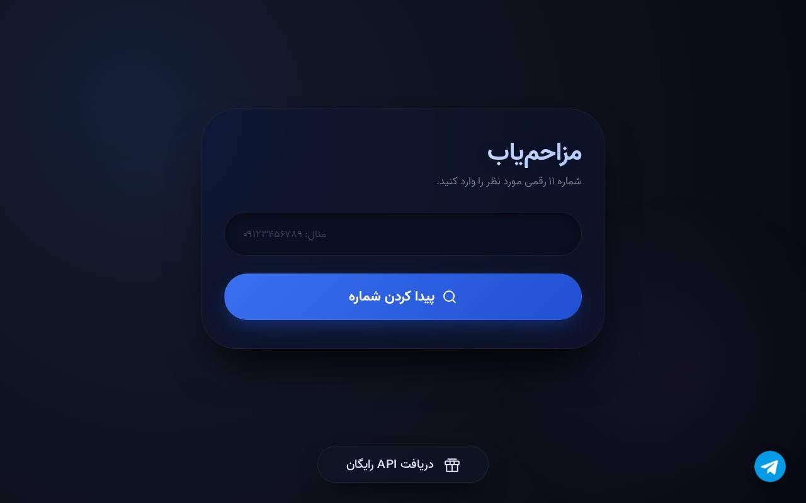

# 📱 Caller Lookup App — مزاحم‌یاب — تشخیص تماس‌های مزاحم

> 📬 **Telegram:** [@Abolfazl_rwm](https://t.me/Abolfazl_rwm)

A single-page Persian web app for **identifying annoying callers**: type any Iranian phone number, hit search, and the app queries a caller-ID API and renders the reported spam labels, categories and community reports. Ships with a tiny Python static server for local serving — CORS is opt-in via the `ALLOWED_ORIGIN` environment variable.

وب‌اپ تک‌صفحه‌ای فارسی برای شناسایی تماس‌های مزاحم — شماره را وارد کنید و جستجو بزنید؛ اپ از API مزاحم‌یاب برچسب‌های گزارش‌شده، دسته‌ی مزاحم و گزارش‌های کاربران را می‌گیرد و نمایش می‌دهد. یک سرور استاتیک پایتون هم برای اجرای محلی همراهش هست — CORS اختیاری است و با متغیر محیطی `ALLOWED_ORIGIN` فعال می‌شود.

  
[**Live demo**](https://abolfazlrwm.github.io/awesome-scripts/src/caller-lookup-app/)

---

## ✨ Features — امکانات

| | |
| --- | --- |
| 🔎 **Phone search** | normalizes Persian digits, validates the ۰۹… format before querying |
| 🏷 **Spam labels** | shows category, report counts and community feedback per number |
| 🌙 **Mobile-first RTL UI** | dark theme, Vazir font (CDN), viewport-safe layout for phones |
| 🔗 **Telegram links** | channel/contact buttons wired into the header |
| 🖥 **Bundled server** | `server.py` serves the folder on any port; cross-origin access is opt-in via `ALLOWED_ORIGIN` |

## 🚀 Setup — نصب و اجرا

```bash
cd src/caller-lookup-app
python server.py            # http://localhost:443 (پورت را در فایل عوض کنید)
# یا هر استاتیک‌سرور دیگری:
python3 -m http.server 8080
```

API مقصد در `index.html` تنظیم می‌شود؛ کلید/آدرس سرویس خودتان را جایگزین کنید.

## 📁 Files — فایل‌ها

```
caller-lookup-app/
├── index.html           # کل اپ (UI + منطق جستجو)
├── server.py            # سرور استاتیک محلی (CORS اختیاری با ALLOWED_ORIGIN)
├── telegram.png         # لوگوی صفحه
└── docs/preview.png
```

## 🧠 How it works — معماری

- **API adapter layer**: a single `apiBtn` fetch wrapper isolates the caller-ID endpoint — swap the base URL and the whole app follows.
- **Local digit handling**: Persian/Arabic digits are converted to ASCII so every input works.
- **Static by design**: no build step, no framework — one HTML file you can host anywhere.

## 📄 License — لایسنس

MIT — see the repository root.


## 🔒 ذکر منبع

> 📬 **Telegram:** [@Abolfazl_rwm](https://t.me/Abolfazl_rwm)

استفاده، ویرایش و بازنشر این سورس **فقط با ذکر منبع** مجاز است — حذف یا تغییر این اعتبار مجاز نیست.