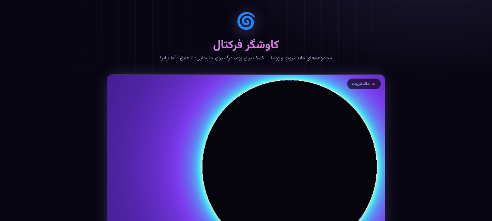

# 🌀 Fractal Explorer — کاوشگر فرکتال

<!-- Telegram: @Abolfazl_rwm -->

<p align="center"></p>

**A live Mandelbrot & Julia set explorer — deep zoom (down to ~10⁵⁵×), smooth escape-time coloring, five palettes, pan/drag, wheel zoom and PNG export — in one offline HTML file with zero libraries.**

کاوش زنده‌ی مجموعه‌های ماندلبروت و ژولیا — زوم عمیق تا ~۱۰⁵⁵ برابر، رنگ‌آمیزی نرم، پنج پالت، جابجایی با درگ، زوم با چرخ موس و خروجی PNG؛ بدون هیچ کتابخانه‌ای در یک فایل HTML آفلاین.

[](https://abolfazlrwm.github.io/awesome-scripts/src/fractal-explorer/)

## ✨ Features

- 🔬 **Two sets** — Mandelbrot (click = zoom, drag = pan) and Julia (drag = tune the constant c *live*, 6 presets)
- 🌀 **Deep zoom** — guarded at double-precision limit (~10⁵⁵×)؛ چرخ موس و دابل‌تپ هم زوم می‌کنند
- 🎨 **Smooth coloring** — continuous iteration count (`mu = n + 1 − log₂log|z|`) mapped through 256-entry LUTs of 5 palettes (شفق، آتش، اقیانوس، نئون رز، مهتاب)
- ⚙️ **Iteration slider** — 80–900, one-click bump while diving deeper
- 🎲 **Lucky dive** — jumps to known-interesting deep coordinates (seahorse valley, triple spiral…) with auto iteration boost
- 💾 **PNG export** — `canvas.toDataURL` with coordinates in the filename
- 📱 **Touch support** — one-finger pan / c-tuning, double-tap zoom
- 🧮 Pure Canvas + typed arrays; coarse renders while interacting, full quality on release
- 🔒 Zero dependencies, works offline from `file://`

## 🚀 Demo / اجرا

```bash
cd src/fractal-explorer
python3 -m http.server 8080   # or just open index.html
```

## 📬 Contact — تماس

[https://t.me/Abolfazl_rwm](https://t.me/Abolfazl_rwm) — Abolfazl


## 🔒 ذکر منبع

> 📬 **Telegram:** [@Abolfazl_rwm](https://t.me/Abolfazl_rwm)

استفاده، ویرایش و بازنشر این سورس **فقط با ذکر منبع** مجاز است — حذف یا تغییر این اعتبار مجاز نیست.