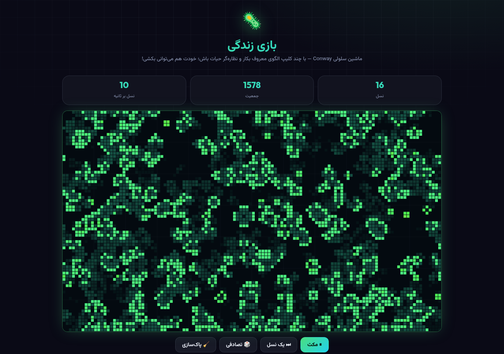

# 🦠 Game of Life — بازی زندگی

<!-- Telegram: @Abolfazl_rwm -->

<p align="center"></p>

**Conway's Game of Life on a 120×70 toroidal grid — stamp famous patterns (Gosper gun, pulsar, glider…), paint cells live, watch age-based colors and fading trails — in one offline HTML file.**

ماشین سلولی Conway روی شبکه‌ی ۱۲۰×۷۰ دورتادور — کاشت الگوهای معروف (توپ گلایدر، پالسار، گلایدر…)، نقاشی زنده‌ی سلول‌ها، رنگ بر اساس سن و ردپای محو شونده؛ همه در یک فایل HTML آفلاین.

[](https://abolfazlrwm.github.io/awesome-scripts/src/game-of-life-web/)

## ✨ Features

- 🧬 **Pattern stamps** — glider, lightweight spaceship, R-pentomino, pulsar and the full 36-cell Gosper glider gun (one click to arm, one click to plant)
- 🖌 **Live painting** — drag to draw/erase cells while paused or running; first click picks paint vs erase
- 🌈 **Age coloring** — cells shift hue as they survive; young = bright green, elders = teal
- ✨ **Fading trails** — dead cells leave decaying ghost marks (toggleable)
- 🌍 **Toroidal wrap** toggle, speed slider (1–30 generations/sec), single-step button
- 📊 Live generation + population counters
- 🔒 Zero dependencies, works offline from `file://`

## 🚀 Demo / اجرا

```bash
cd src/game-of-life-web
python3 -m http.server 8080   # or just open index.html
```

## 📬 Contact — تماس

[https://t.me/Abolfazl_rwm](https://t.me/Abolfazl_rwm) — Abolfazl


## 🔒 ذکر منبع

> 📬 **Telegram:** [@Abolfazl_rwm](https://t.me/Abolfazl_rwm)

استفاده، ویرایش و بازنشر این سورس **فقط با ذکر منبع** مجاز است — حذف یا تغییر این اعتبار مجاز نیست.