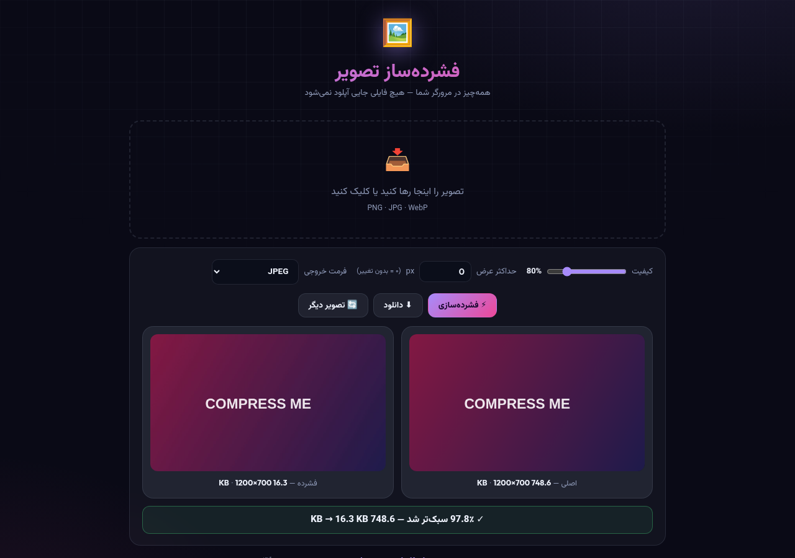

# 🖼️ Image Compressor — فشرده‌ساز تصویر

<!-- Telegram: @Abolfazl_rwm -->

<p align="center"></p>

**A browser-only image compressor — quality slider, resize, WebP/JPEG/PNG output and a before-after compare, with zero uploads.**

فشرده‌ساز تصویر فقط با مرورگر — اسلایدر کیفیت، تغییر ابعاد، خروجی WebP/JPEG/PNG و مقایسه‌ی قبل/بعد، بدون هیچ آپلودی.

[](https://abolfazlrwm.github.io/awesome-scripts/src/image-compressor-web/)

## ✨ Features

- 🎚 **Quality slider (10–100%)** and **max-width resize** re-encode on demand via Canvas
- 🧪 **Three output formats** — JPEG, WebP (best savings) and lossless PNG
- 🆚 **Side-by-side compare** — original vs compressed with sizes, dimensions and a savings badge
- ⬇️ **One-click download** with an auto-named file
- 🔐 **100% local** — images never leave the browser; verified 1.97 MB PNG → 185 KB JPEG (90.8% lighter)
- 🔒 Zero dependencies, works offline from `file://`

## 🚀 Demo / اجرا

```bash
cd src/image-compressor-web
python3 -m http.server 8080   # or just open index.html
```

## 📬 Contact — تماس

[https://t.me/Abolfazl_rwm](https://t.me/Abolfazl_rwm) — Abolfazl


## 🔒 ذکر منبع

> 📬 **Telegram:** [@Abolfazl_rwm](https://t.me/Abolfazl_rwm)

استفاده، ویرایش و بازنشر این سورس **فقط با ذکر منبع** مجاز است — حذف یا تغییر این اعتبار مجاز نیست.