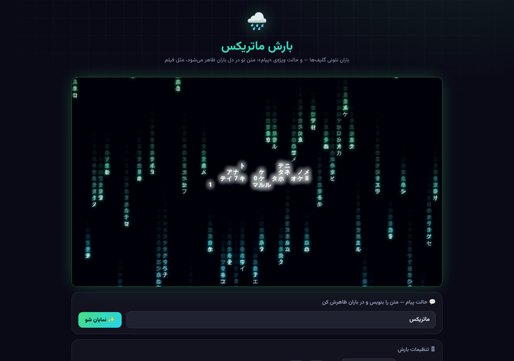

# 🌧 Matrix Rain — بارش ماتریکس

<!-- Telegram: @Abolfazl_rwm -->

<p align="center"></p>

**The iconic Matrix digital rain — katakana / binary / hex / Persian glyph sets, dual-color gradients, speed and density sliders, and a message mode that reveals your text inside the rain — in one offline HTML file.**

باران دیجیتال معروف ماتریکس — گلیف‌های کاتاکانا/باینری/هگز/فارسی، گرادینت دو رنگ، اسلایدر سرعت و تراکم، و حالت پیام که متن تو را در دل باران نمایان می‌کند؛ همه در یک فایل HTML آفلاین.

[](https://abolfazlrwm.github.io/awesome-scripts/src/matrix-rain-web/)

## ✨ Features

- 🌧 **Classic rain** — glowing white head glyph + colored echo, trail fade via translucent overpaint
- 💬 **Message reveal** — your text is rasterized to an offscreen bitmap, sampled to a glyph grid, then lit column-by-column as falling heads pass the target rows; holds ~4s and dissolves back into rain
- 🔤 **4 glyph sets** — katakana, binary `01`, hex, Persian letters + Persian digits
- 🎨 **Dual-color gradient** — head color morphs to a second color along the screen depth
- 🎛 Speed / density sliders, rain reset, PNG frame export
- 🔒 Zero dependencies, works offline from `file://`

## 🚀 Demo / اجرا

```bash
cd src/matrix-rain-web
python3 -m http.server 8080   # or just open index.html
```

## 📬 Contact — تماس

[https://t.me/Abolfazl_rwm](https://t.me/Abolfazl_rwm) — Abolfazl


## 🔒 ذکر منبع

> 📬 **Telegram:** [@Abolfazl_rwm](https://t.me/Abolfazl_rwm)

استفاده، ویرایش و بازنشر این سورس **فقط با ذکر منبع** مجاز است — حذف یا تغییر این اعتبار مجاز نیست.