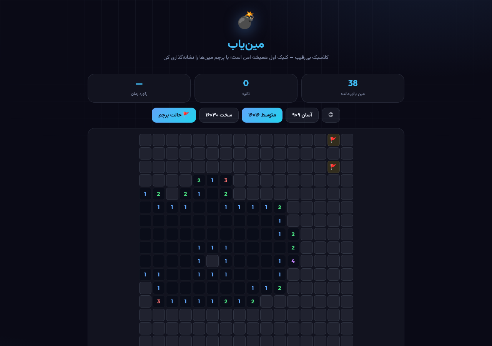

# 💣 Minesweeper — مین‌یاب

<!-- Telegram: @Abolfazl_rwm -->

<p align="center"></p>

**The classic Minesweeper — three difficulties, always-safe first click, flags via right-click or long-press, timer and per-difficulty best times — in one offline HTML file.**

مین‌یاب کلاسیک — سه سختی، کلیک اول همیشه امن، پرچم با راست‌کلیک یا نگه‌داشتن انگشت، تایمر و رکورد زمان هر سختی — همه در یک فایل HTML آفلاین.

[](https://abolfazlrwm.github.io/awesome-scripts/src/minesweeper-web/)

## ✨ Features

- 🎚 **Three difficulties** — beginner 9×9/10, intermediate 16×16/40, expert 30×16/99 with adaptive cell sizing
- 🛡 **Safe first click** — mines are planted *after* the first reveal, excluding that cell and its neighbors
- 🚩 **Flag everywhere** — right-click on desktop, 380 ms long-press on touch (with haptic), or a flag-mode toggle button
- 🌊 **Flood reveal** — zero cells cascade open via BFS, classic number coloring
- ⏱ **Timer + best times** per difficulty in localStorage; face button 😊😵😎 tracks the game state
- 🔒 Zero dependencies, works offline from `file://`

## 🚀 Demo / اجرا

```bash
cd src/minesweeper-web
python3 -m http.server 8080   # or just open index.html
```

## 📬 Contact — تماس

[https://t.me/Abolfazl_rwm](https://t.me/Abolfazl_rwm) — Abolfazl


## 🔒 ذکر منبع

> 📬 **Telegram:** [@Abolfazl_rwm](https://t.me/Abolfazl_rwm)

استفاده، ویرایش و بازنشر این سورس **فقط با ذکر منبع** مجاز است — حذف یا تغییر این اعتبار مجاز نیست.