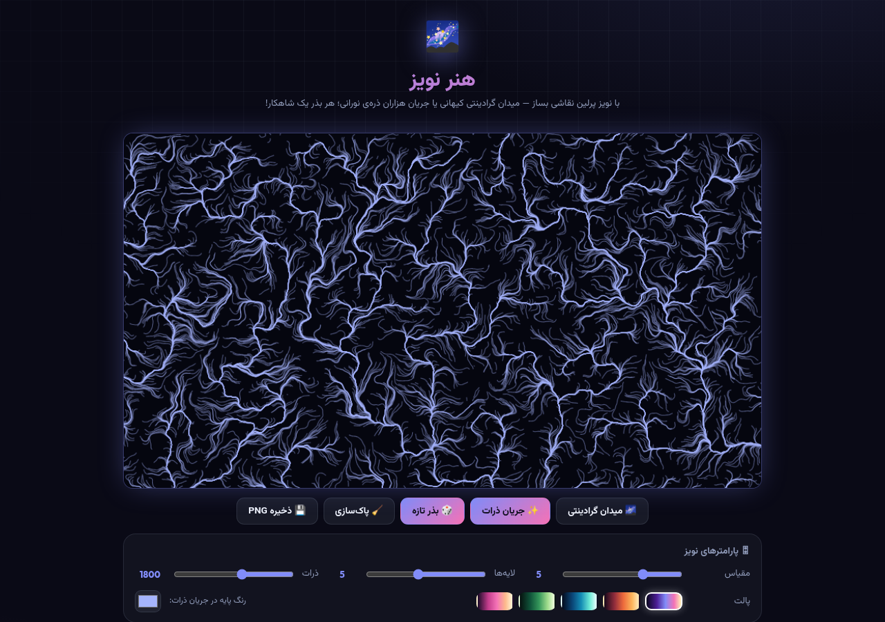

# 🌌 Noise Art — هنر نویز

<!-- Telegram: @Abolfazl_rwm -->

<p align="center"></p>

**Generative art from Perlin-style noise — cosmic gradient fields rendered from fBm, or thousands of flow-field particles painting silky streaks — with 5 palettes, live sliders and PNG export — in one offline HTML file.**

هنر مولد با نویز پرلین — میدان‌های گرادینتی کیهانی از fBm، یا هزاران ذره‌ی میدانِ جریان که رگه‌های ابریشمی نقاشی می‌کنند — با ۵ پالت، اسلایدرهای زنده و خروجی PNG؛ همه در یک فایل HTML آفلاین.

[](https://abolfazlrwm.github.io/awesome-scripts/src/noise-art-web/)

## ✨ Features

- 🧠 **Hand-rolled value noise** — lattice hash + smootherstep interpolation, stacked into fBm with 1–8 octaves
- 🌌 **Gradient field mode** — noise value → 256-entry palette LUT, rendered on a 2px grid (کیهانی، غروب، اقیانوس، جنگل، آبنبات)
- ✨ **Flow mode** — up to 4000 particles steered by `angle = fbm(x, y) · 4π`, painting translucent streaks with per-particle lifetimes
- 🎲 **Seed dice** — every seed is a brand-new artwork; scale/octave sliders reshape it live
- 💾 PNG export named by seed
- 🔒 Zero dependencies, works offline from `file://`

## 🚀 Demo / اجرا

```bash
cd src/noise-art-web
python3 -m http.server 8080   # or just open index.html
```

## 📬 Contact — تماس

[https://t.me/Abolfazl_rwm](https://t.me/Abolfazl_rwm) — Abolfazl


## 🔒 ذکر منبع

> 📬 **Telegram:** [@Abolfazl_rwm](https://t.me/Abolfazl_rwm)

استفاده، ویرایش و بازنشر این سورس **فقط با ذکر منبع** مجاز است — حذف یا تغییر این اعتبار مجاز نیست.