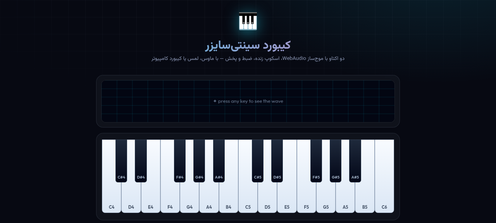

# 🎹 Synthwave Keys — کیبورد سینتی‌سایزر

<!-- Telegram: @Abolfazl_rwm -->

<p align="center"></p>

**A two-octave WebAudio synthesizer — four oscillator shapes, octave shifting, a live gradient oscilloscope, pointer/touch/computer-keyboard input and a recorder with playback — in one offline HTML file.**

سینتی‌سایزر دو اکتاوی با WebAudio — چهار شکل موج، تغییر اکتاو، اسکوپ گرادینتی زنده، ورودی با ماوس/لمس/کیبورد و ضبط با قابلیت پخش؛ همه در یک فایل HTML آفلاین.

[](https://abolfazlrwm.github.io/awesome-scripts/src/synthwave-keys/)

## ✨ Features

- 🎼 **25 keys (C4–C6)** — DOM-rendered piano with per-key glow on press, mouse/touch/multi-event input
- 🌊 **Four oscillator shapes** — sine, square, sawtooth, triangle — hot-swappable on held notes
- 🎚 **Real synthesis controls** — octave shift (2–6), volume, sustain mode (hold or release)
- 📺 **Live oscilloscope** — `AnalyserNode` time-domain data drawn on a glowing gradient canvas at 60fps
- ⏺ **Recorder** — captures note-on/off events with timestamps, persisted in localStorage, played back with exact timing
- ⌨️ **Tracker keyboard layout** — `Z–M` + `Q–U` rows, black keys on `S D G H J` / `2 3 5 6 7`, `Shift` = +1 octave
- 🎛 **Proper envelope** — 15ms exponential attack, 220ms release (1.4s with sustain)
- 🔒 Zero dependencies, works offline from `file://`

## 🚀 Demo / اجرا

```bash
cd src/synthwave-keys
python3 -m http.server 8080   # or just open index.html
```

## 📬 Contact — تماس

[https://t.me/Abolfazl_rwm](https://t.me/Abolfazl_rwm) — Abolfazl


## 🔒 ذکر منبع

> 📬 **Telegram:** [@Abolfazl_rwm](https://t.me/Abolfazl_rwm)

استفاده، ویرایش و بازنشر این سورس **فقط با ذکر منبع** مجاز است — حذف یا تغییر این اعتبار مجاز نیست.