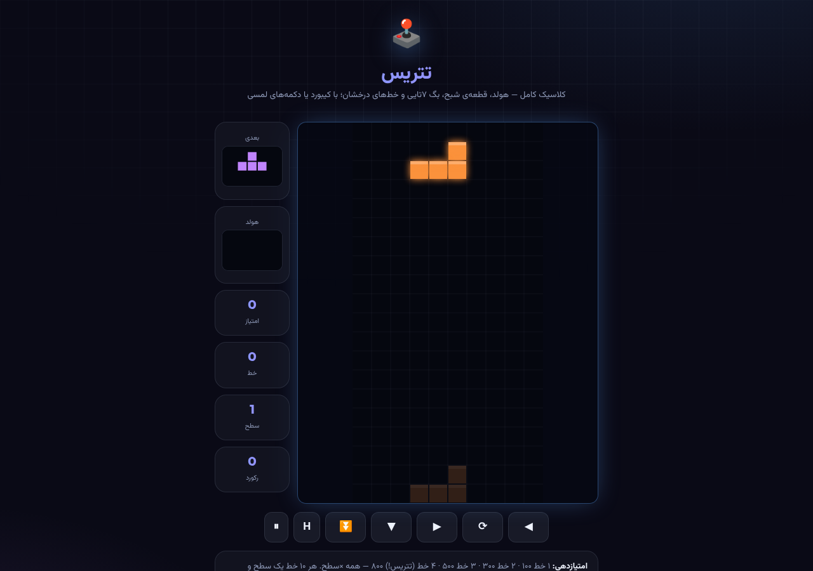

# 🕹 Tetris Web — تتریس

<!-- Telegram: @Abolfazl_rwm -->

<p align="center"></p>

**A complete Tetris — 7-bag randomizer, hold slot, ghost piece, wall-kick rotation, line-clear flash animation, level acceleration and touch buttons — in one offline HTML file.**

تتریس کامل — بگ ۷تایی، اسلات هولد، قطعه‌ی شبح، چرخش با wall-kick، فلش خط‌های کامل، تندشوندگی بر اساس سطح و دکمه‌های لمسی؛ همه در یک فایل HTML آفلاین.

[](https://abolfazlrwm.github.io/awesome-scripts/src/tetris-web/)

## ✨ Features

- 🎲 **7-bag randomizer** — classic fair piece distribution, no long droughts
- 🫱 **Hold slot** — stash a piece once per drop (`C` or on-screen button)
- 👻 **Ghost piece** — translucent landing preview at the drop column
- 💥 **Line-clear flash** — full rows blink white before collapsing
- 🎯 **Scoring** — 100/300/500/800 × level + soft/hard-drop points; level up every 10 lines with `0.85^n` gravity
- 🧱 **Wall kicks** — rotation retries at offsets `0, ±1, ±2` so T-spins near walls still work
- 📱 **Touch controls** — ◀ ⟳ ▶ ▼ ⏬ H ⏸ buttons for phones
- 🏆 **Personal best** persisted in localStorage
- 🔒 Zero dependencies, works offline from `file://`

## 🚀 Demo / اجرا

```bash
cd src/tetris-web
python3 -m http.server 8080   # or just open index.html
```

## 📬 Contact — تماس

[https://t.me/Abolfazl_rwm](https://t.me/Abolfazl_rwm) — Abolfazl


## 🔒 ذکر منبع

> 📬 **Telegram:** [@Abolfazl_rwm](https://t.me/Abolfazl_rwm)

استفاده، ویرایش و بازنشر این سورس **فقط با ذکر منبع** مجاز است — حذف یا تغییر این اعتبار مجاز نیست.