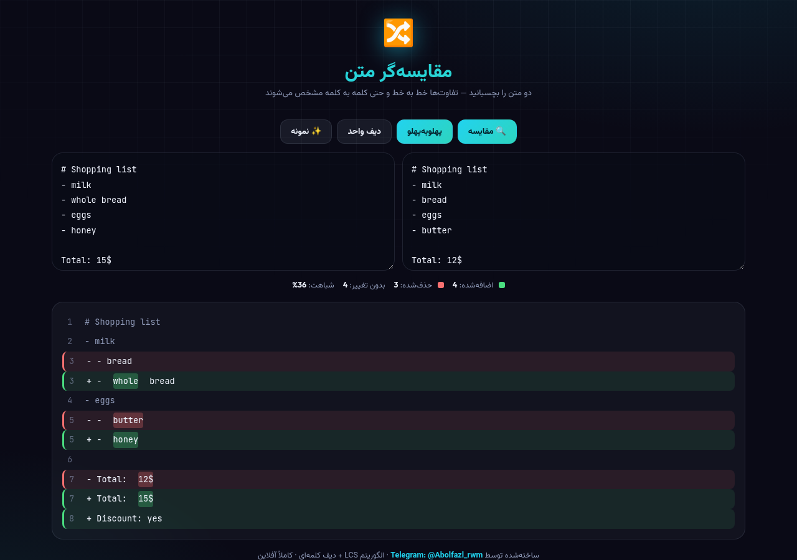

# 🔀 Text Diff — مقایسه‌گر متن

<!-- Telegram: @Abolfazl_rwm -->

<p align="center"></p>

**A text differ with LCS-based line diff, word-level highlighting inside changed pairs and a similarity score — in one offline HTML file.**

مقایسه‌گر متن با دیف خطی مبتنی بر LCS، هایلایت کلمه‌ای درون خطوط تغییر کرده و امتیاز شباهت — همه در یک فایل HTML آفلاین.

[](https://abolfazlrwm.github.io/awesome-scripts/src/text-diff-web/)

## ✨ Features

- 🔍 **LCS line diff** — dynamic programming alignment marks every added, removed and unchanged line
- ✏️ **Word-level drill-down** — changed line pairs get a second pass so the exact word differences glow
- 📊 **Live stats** — added / removed / unchanged counts plus a similarity percentage
- 🔢 **Line numbers** and optional paired/changed grouping for readable output
- ⚡ **Guarded for big inputs** — full DP up to ~120k cells, graceful prefix alignment beyond
- 🔒 Zero dependencies, works offline from `file://`

## 🚀 Demo / اجرا

```bash
cd src/text-diff-web
python3 -m http.server 8080   # or just open index.html
```

## 📬 Contact — تماس

[https://t.me/Abolfazl_rwm](https://t.me/Abolfazl_rwm) — Abolfazl


## 🔒 ذکر منبع

> 📬 **Telegram:** [@Abolfazl_rwm](https://t.me/Abolfazl_rwm)

استفاده، ویرایش و بازنشر این سورس **فقط با ذکر منبع** مجاز است — حذف یا تغییر این اعتبار مجاز نیست.