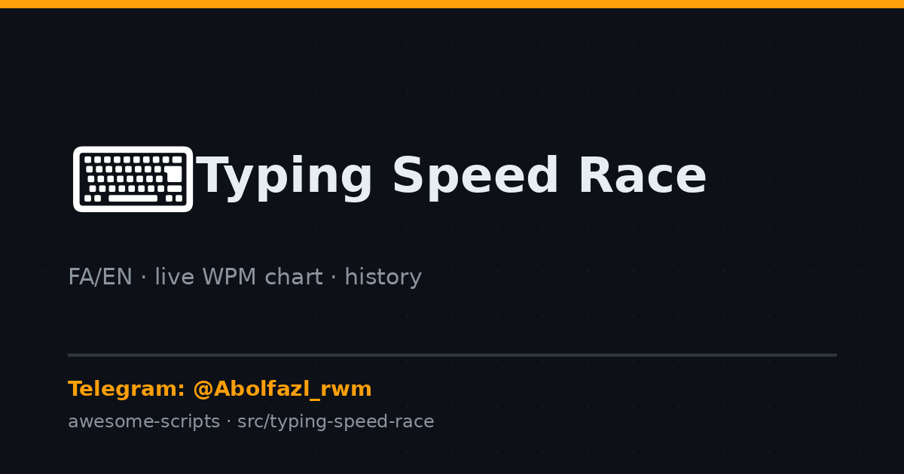

# ⌨️ Typing Speed Race — مسابقه‌ی سرعت تایپ

<!-- Telegram: @Abolfazl_rwm -->

<p align="center"></p>

**A live typing-speed test in Persian AND English — per-character feedback, real-time WPM curve, accuracy, results history — all in a single offline HTML file with hand-written practice sentences.**

تست سرعت تایپ فارسی و انگلیسی — رنگ‌بندی حرف‌به‌حرف، نمودار زنده‌ی WPM، دقت و تاریخچه‌ی نتایج؛ همه در یک فایل HTML آفلاین با جمله‌های تمرینی دست‌نویس.

[](https://abolfazlrwm.github.io/awesome-scripts/src/typing-speed-race/)

## ✨ Features

- 🇮🇷🇬🇧 **FA/EN modes** — RTL-aware rendering, ی/ک normalization, Vazirmatn + Outfit typography
- ⏱ **30s / 60s** runs — timer starts on your first keystroke
- 🔊 **Keypress audio** — a soft click for hits, a low buzz for misses (toggleable)
- 🎨 **Per-character coloring** — done / error / blinking caret, glassmorphism UI with dark & light themes
- 📈 **Live WPM chart** — hand-drawn canvas curve with gradient area & glow, no chart libraries
- 🔥 **Mistake heatmap** — the session's problem keys ranked as intensity-colored chips
- 🏆 **PB celebration** — animated counters, personal best per language+duration, hand-written confetti burst
- 📜 **History** — last 8 runs persisted in localStorage
- ⌨️ `Tab` restarts instantly; zero dependencies, works from `file://`

## 🚀 Demo / اجرا

```bash
cd src/typing-speed-race
python3 -m http.server 8080   # or just open index.html
```

## 📬 Contact — تماس

[https://t.me/Abolfazl_rwm](https://t.me/Abolfazl_rwm) — Abolfazl


## 🔒 ذکر منبع

> 📬 **Telegram:** [@Abolfazl_rwm](https://t.me/Abolfazl_rwm)

استفاده، ویرایش و بازنشر این سورس **فقط با ذکر منبع** مجاز است — حذف یا تغییر این اعتبار مجاز نیست.